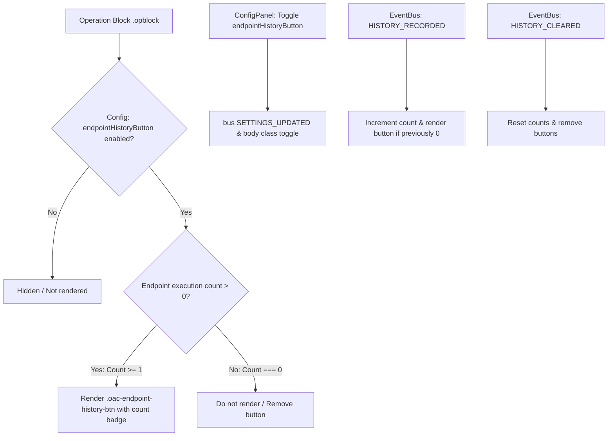

# Implementation Plan: Endpoint History Button Visibility & Config Toggle

Configure the in-page **"🕒 History"** button on Swagger UI operation blocks to:
1. **Show only when past API history exists** (`count > 0`); do not show if 0 executions.
2. **Add a feature toggle in Config tab** (`endpointHistoryButton`) so developers can enable/disable this feature in settings.

---

## 1. User Requirements
- **Only show if there is API history**: If an endpoint has never been executed (`count === 0`), do not display the button. As soon as a request completes (`HISTORY_RECORDED`), the button immediately renders with its count.
- **Config Toggle**: Add a dedicated feature toggle in the Config panel (`endpointHistoryButton` under Swagger Features) so developers can turn the button on or off anytime.

---

## 2. Proposed Architecture & File Changes



### Proposed Changes

#### A. Settings & Config Toggle
1. **`src/modules/settings/types.ts`**:
   - Add `endpointHistoryButton: boolean` to `SwaggerFeaturePreferences`.
   - Add `endpointHistoryButton: true` to `DEFAULT_SWAGGER_FEATURES`.

2. **`src/modules/config/ConfigPanel.tsx`**:
   - Add metadata entry to `FEATURE_METADATA`:
     ```ts
     {
       id: 'endpointHistoryButton',
       title: 'In-Page Endpoint Execution History Button',
       description:
         'Display a "History" button with past execution count on operation blocks to open the request/response history overlay.',
     }
     ```

3. **`src/content/index.tsx`**:
   - In `applySwaggerFeatureClasses`:
     `b.classList.toggle('oac-disable-endpoint-history-button', !features.endpointHistoryButton)`
   - In `ensureSwaggerFeatureStyles`:
     `body.oac-disable-endpoint-history-button .oac-endpoint-history-btn { display: none !important; }`

#### B. Conditional Rendering (History Exists Only)
4. **`src/content/swagger-endpoint-history-button.ts`**:
   - In `scanAndMount`:
     - If `doc.body?.classList.contains('oac-disable-endpoint-history-button')`: remove any mounted buttons and return.
     - Check `count = counts.get(endpointId) ?? 0`.
     - If `count <= 0`:
       - If a button was previously mounted on this block, remove it (`existingBtn.remove()`).
       - Do not mount a new button; skip this block.
     - If `count > 0`:
       - Mount or update the button with `<span class="oac-history-count-badge">{count}</span>`.
   - On `HISTORY_RECORDED`:
     - Increment count for `endpointId`.
     - Run `scanAndMount(doc)` to instantly show the button on that endpoint if it was previously hidden.
   - On `HISTORY_CLEARED`:
     - Clear counts map and remove all buttons.

#### C. Automated Tests
5. **`src/modules/settings/settings-service.test.ts`**:
   - Verify `endpointHistoryButton` defaults to `true`.
6. **`src/content/swagger-endpoint-history-button.test.ts`**:
   - Test: Button is **not** rendered when count === 0.
   - Test: Button is rendered when count > 0.
   - Test: Button dynamically appears when `HISTORY_RECORDED` occurs for an endpoint with 0 history.
   - Test: Button is removed when `HISTORY_CLEARED` occurs.
   - Test: Button is hidden when disabled via CSS/class.

#### D. Documentation & Tracking
7. **`walkthrough.md`**:
   - Document the count > 0 condition and the new Config panel feature toggle.

---

## 3. Verification Plan
- Run `npm run format`
- Run all 7 mandatory CI quality gates locally:
  1. `npm run lint`
  2. `npm run format:check`
  3. `npm run typecheck`
  4. `npm test`
  5. `npm audit --omit=dev --audit-level=high`
  6. `npm run build`
  7. `npm run test:e2e`
